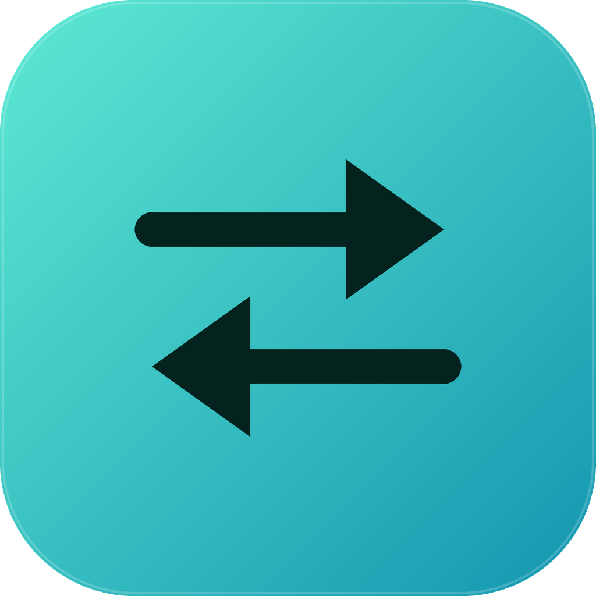
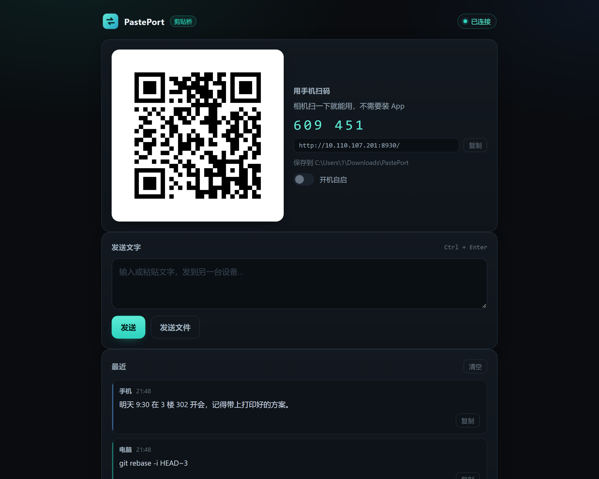
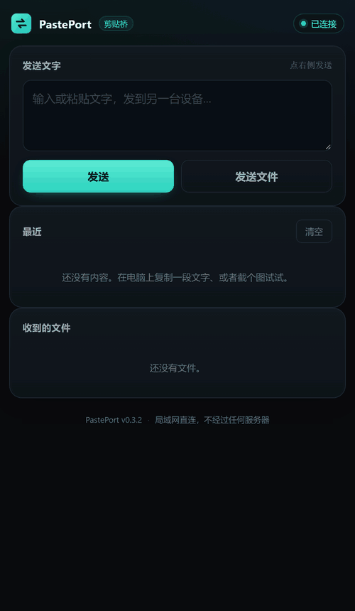

<div align="center">



# PastePort · 剪贴桥

**电脑上 `Ctrl+C`，手机上 `Ctrl+V`。**

局域网直连 · 不经过任何服务器 · 手机连 App 都不用装

<p>
  <a href="../../releases/latest"></a>
  <a href="../../releases/latest"></a>
</p>

<p>
  
  
  
  
</p>

</div>



<p align="center"><sub>电脑上的控制台：手机扫码就连上，下面是两台设备之间的全部往来 —— 文字、截图、文件</sub></p>

## 30 秒上手

| 步骤 | 做什么 |
|---|---|
| 1 | 下载 [`PastePort.exe`](../../releases/latest)，双击 |
| 2 | 弹出黑窗口，上面是二维码 —— **不用管它，浏览器已经自动打开控制台** |
| 3 | 手机相机扫控制台上的二维码（或者手输窗口里的地址） |
| 4 | 手机上直接就能用了 —— **不用装 App、不用注册、不用登录** |
| 5 | 现在在电脑上复制任何文字，手机上点一下就能粘贴 |

> 扫不出来？看下面的[「扫不出来 / 扫了打不开？」](#扫不出来--扫了打不开)。最省事的办法是**右键托盘图标 →「显示二维码」**，扫那张图。

<details>
<summary>双击之后，控制台长这样</summary>

```text
  PastePort 剪贴桥  v0.3.3
  ─────────────────────────────────────────────
  电脑     DESKTOP-XXXXXX
  地址     http://192.168.1.8:8787/
  配对码   503 468
  保存到   C:\Users\you\Downloads\PastePort

  手机扫码即可使用，无需安装 App：

  █████████████████████████████████
  ██ ▄▄▄▄▄ ██▄▀▀ ▄ ▀▄ █ ▄█ ▄▄▄▄▄ ██
  ██ █   █ █▄  ▀▄  █ █▄▄ █ █   █ ██
  ██ █▄▄▄█ ██▀▄██▀▄ ▄ █  █ █▄▄▄█ ██
  ██▄▄▄▄▄▄▄█ ▀ █ ▀ █ ▀▄▀▄█▄▄▄▄▄▄▄██
  ██   ▀▄ ▄▄▄█  ██ ██▄ ██▄ ▀█▀▄█▀██
  ███▄▀▄ ▀▄▄ ▄█▀█▄█▀ ▀ ▀▄▀▄ ▄▀▄ ▄██
  ██▀▀  █ ▄██▀█▀ ▀███▄ ██▀  █ ▀▄ ██
  ██▄▄ ▄▄▀▄▀ ▀ ▄ ▀ ██▀ █▄ ▀ ▄▀█ ▄██
  ███ ▄▀  ▄▀▀▄  ██ ██▄▄███  ██▀▄ ██
  ██▄▀ ██▄▄▄ ▀▀▀█▄█▀▄ ▀█ █▄█▀ █ ▄██
  ██▄██▄▄█▄▄ ▄▀▀ ▀███ ▄  ▄▄▄ █▀▀▀██
  ██ ▄▄▄▄▄ █ ██▄ ▀ ▀▀    █▄█  █ ▄██
  ██ █   █ █▄▄  ██ ██ ██  ▄   █  ██
  ██ █▄▄▄█ █ ▀▀▀█▄█▀▀  ▄  █▀▄ ▄▀▄██
  ██▄▄▄▄▄▄▄█▄▄██▄██▄█▄▄█▄█▄█▄▄█▄▄██
  █████████████████████████████████

  配对码和地址也从托盘图标的右键菜单里复制。关掉这个窗口不影响使用。
```

</details>


<p align="center">
  
</p>

<p align="center"><sub>手机端实录 —— 电脑上复制文字、截图，这边一条条出现。浏览器打开就行，不装任何东西</sub></p>

## 这玩意儿解决什么

你肯定干过这些事：

- 想在手机上粘贴电脑里的一段文字 → **打开微信 → 搜"文件传输助手" → 发给自己 → 手机上再打开微信**
- 想把手机拍的照片传到电脑 → **插数据线 / 发文件传输助手 / 上云盘**
- 想把手机上的验证码、链接、地址发到电脑 → **还是文件传输助手**

为了传 20 个字，你要经过一整个云服务。

PastePort 把这件事变成：**电脑上复制，手机上直接粘贴。** 中间没有任何服务器，两个设备就在同一个 Wi-Fi 里。

## 它能干什么

| 功能 | 说明 |
|---|---|
| 📋 **双向剪贴板** | 电脑复制 → 手机推送；手机输入 → 电脑剪贴板 |
| 📷 **截图直传** | 在电脑上截个图 `Ctrl+C`，手机端直接看到图片，可保存 |
| 📁 **双向传文件** | 手机选文件传到电脑；电脑拖文件进浏览器，手机点下载 |
| 📱 **扫码即用** | 手机端零安装，相机扫一下就在浏览器里跑起来 |
| 🔍 **自动发现** | 广播 + 网段扫描双保险；路由器挡广播也能找到，不用记 IP |
| 📤 **系统分享入口** | 任何 App 里「分享 → PastePort」，文字直接进电脑剪贴板 |
| 🔒 **配对码保护** | 6 位配对码 + 随机令牌，别人连不上；连错 5 次锁 60 秒 |
| 🎛 **托盘常驻** | 关掉黑窗口也不影响使用；右键菜单能打开控制台、复制配对码、开关开机自启、退出 |
| 🚀 **开机自启** | 登录 Windows 自动在托盘里启动，只写 `HKCU`，不需要管理员权限 |
| 1️⃣ **单实例** | 重复双击只会把已经开着的控制台叫出来，不会多占一个端口 |
| 🪶 **单文件** | Windows 端就是一个 **7 MB** 的 exe，Android 端就是一个 **53 KB** 的 apk —— 没有安装器、没有运行库、没有 node_modules |

### APK 比网页多什么

手机浏览器打开的是 `http://` 局域网地址，属于**非安全上下文**，浏览器会禁用 `navigator.clipboard` —— 这不是 bug，是规范。所以网页版复制靠的是兼容写法，个别浏览器会失败。

装了 APK 之后：

- **剪贴板走原生** —— 复制 100% 可靠
- **自动发现电脑** —— 不用记 IP 和端口
- **分享菜单直达** —— 你在别的 App 里看到一段文字，分享给 PastePort，它就出现在电脑剪贴板里，不用切 App

APK 只申请 **`INTERNET`** 一个权限。没有相机、没有存储、没有通讯录、没有定位。

## 它怎么工作的

```
┌─────────────────────────┐              ┌──────────────────────────┐
│  Windows: PastePort.exe │              │  手机: 浏览器 / PastePort.apk │
│                         │              │                          │
│  ┌───────────────────┐  │   同一个 Wi-Fi │  ┌────────────────────┐  │
│  │ 剪贴板监听 (Win32) │  │◄────────────►│  │  扫码打开网页 / WebView │  │
│  └─────────┬─────────┘  │              │  └──────────┬─────────┘  │
│            │ 变化        │   SSE 推送    │             │            │
│  ┌─────────▼─────────┐  │  HTTP POST    │  ┌──────────▼─────────┐  │
│  │  事件广播 Hub      │◄─┼──────────────┼─►│  发送文字 / 文件       │  │
│  └─────────┬─────────┘  │              │  └────────────────────┘  │
│            │             │              │                          │
│  ┌─────────▼─────────┐  │   UDP 45679  │  ┌────────────────────┐  │
│  │ 内嵌 Web UI + API  │◄─┼──────────────┼─►│  广播「谁在这儿？」     │  │
│  └───────────────────┘  │   自动发现     │  └────────────────────┘  │
└─────────────────────────┘              └──────────────────────────┘
```

- **桌面端**：Go 写的单个可执行文件，`net/http` 起服务，前端用 `embed` 打包进去 —— 所以只有一个 exe，没有 `node_modules`，没有安装器。
- **传输**：服务端推送用 **SSE**（`text/event-stream`），客户端发消息用普通 **POST**。比 WebSocket 少一半代码，穿透性更好，断线浏览器会自动重连。
- **发现**：手机往 `255.255.255.255:45679` 广播一句，电脑应答自己的名字和端口。发现 ≠ 认证，连接仍然要过配对码。
- **剪贴板**：Windows 端直接调 `user32.dll` / `kernel32.dll`（`OpenClipboard`、`GetClipboardData`…），用 `GetClipboardSequenceNumber` 判断有没有新内容，不轮询字符串、几乎不占 CPU。

### 它为什么这么小

零第三方依赖。QR 编码器（`rsc.io/qr`）已经 vendor 进仓库，除此之外全是 Go 标准库。

```
pasteport/
├── cmd/pasteport/      桌面端入口
├── internal/app/       配置 / 事件总线 / 剪贴板 / 发现 / HTTP 服务
├── internal/qr/        内嵌的二维码编码器（BSD，已 vendor）
├── web/                前端（原生 HTML/CSS/JS，无构建步骤）
├── android/            Android 原生壳（Java，无 Gradle 依赖）
└── scripts/            构建脚本
```

## 命令行

```
PastePort.exe [参数]

  --port 8787          监听端口（默认 8787，被占用会自动往后找）
  --save <目录>         收到的文件存哪（默认 下载/PastePort）
  --name <名字>         手机上显示的名字（默认电脑名）
  --data <目录>         配置目录（默认自动找可写位置）
  --no-open            不自动打开浏览器
  --tray               静默启动：隐藏控制台，只留在托盘里
  --no-tray            不显示托盘图标（调试用）
  --install-startup    加入开机自启后退出
  --uninstall-startup  取消开机自启后退出
  --version            打印版本
```

托盘图标右键：**打开控制台 / 复制配对码 / 开机自启 / 退出**。左键双击直接打开控制台。
开机自启写的是 `HKCU\Software\Microsoft\Windows\CurrentVersion\Run`，命令是 `"<exe>" --tray --no-open`，不需要管理员权限，删掉这个注册表值也能关掉。

配置文件在 `%APPDATA%\PastePort\config.json`，里面存着配对码和令牌。想换配对码，删掉这个文件重启即可。

## 扫不出来 / 扫了打不开？

按这个顺序排查，90% 的情况在前两条就解决了：

**1. 别扫终端里的字符画，扫图片。**

终端的二维码是拿方块字符拼的，能不能扫取决于你的字体和配色。浅色主题下整张码是反色的（白底黑码变成黑底白码），很多手机相机——尤其是微信——不认反色码。

正确姿势：**右键托盘图标 →「显示二维码」**，会打开一张 296×296 的 PNG，扫这张。或者浏览器控制台里那个二维码，它也是按原始像素显示的。

**2. 确认手机和电脑真的在同一个网络。**

在手机浏览器里直接输入控制台显示的地址（比如 `http://192.168.1.8:8787/`）。打不开就是网络问题，跟二维码无关。

**3. 电脑有多个网卡时，换一个地址试。**

装了 VMware / VirtualBox / WSL / VPN 的机器会有好几个 IP，程序选的那个未必是手机能到的那个。网页控制台里地址下面有个下拉框，逐个切换，哪个能打开手机就用哪个。

**4. Windows 防火墙：两条规则都要，只放行 TCP 是不够的。**

局域网自动发现走的是 **UDP 45679**，网页和文件传输走 **TCP 8787**。只开 TCP 的话，手机能扫码连上，但 APK 里永远搜不到电脑。

用管理员 PowerShell 一次补齐（把 8787 换成你实际用的端口）：

```powershell
netsh advfirewall firewall add rule name="PastePort TCP" dir=in action=allow protocol=TCP localport=8787
netsh advfirewall firewall add rule name="PastePort UDP" dir=in action=allow protocol=UDP localport=45679
```

**5. 手机搜不到电脑？先看电脑上的日志。**

v0.3.3 起，控制台会实时打印收到的发现请求：

```
  · 局域网发现已开启（UDP 45679）
  · 收到发现请求：192.168.1.23:53914
```

- **有这行** → 网络是通的，问题在手机端（点 APK 里的「重新搜索」）
- **一直没有** → 包根本没到电脑：防火墙没放行 UDP，或者两台设备不在同一网段

**6. 广播被路由器挡住也不要紧。**

有些路由器不转发广播（尤其是开了 AP 隔离或"访客网络"）。v0.3.3 的 APK 在广播失败后会自动**扫描本网段**，用 `/api/info` 逐个确认是不是 PastePort —— 最多多花几秒，但能把它找出来。

**7. 实在不行就手输配对码。**

二维码只是个便利。手机浏览器打开地址后，输入控制台上那 6 位配对码，效果完全一样。

## 安全与隐私

说得直白一点：

- ✅ **数据不出局域网**。没有云端、没有账号、没有遥测、没有统计接口。你可以拔了网线用，一样能跑。
- ✅ **有配对码**。同一个 Wi-Fi 下的其他人扫码/猜码才能连上；连错 5 次锁定 60 秒。
- ⚠️ **HTTP 是明文的**。局域网内如果有人在抓包，能看到你传的内容。家庭和办公内网够用，**公共 Wi-Fi（咖啡厅、机场）别开**。
- ⚠️ **配对码存在本地配置文件里**，有本机文件读权限的人能看到。

这些限制是刻意的取舍：加密会带来证书信任问题（自签证书浏览器要报警告），对小工具来说反而更难用。如果你需要跨不可信网络，别用这个。

## 从源码构建

需要 Go 1.21+；构建 APK 另外需要 JDK 17+ 和 Android SDK 的 `platform-34` + `build-tools;34.0.0`。

```powershell
# Windows exe（约 10 秒）
.\scripts\build-exe.ps1

# Android apk（没有 Gradle，直接 aapt2 + javac + d8 + apksigner）
.\scripts\setup-android-sdk.ps1 -Sdk "C:\Android\sdk"     # 一次性，只下两块组件
.\scripts\build-apk.ps1 -Sdk "C:\Android\sdk" -JdkHome "C:\Program Files\Microsoft\jdk-21"
```

两个产物都会输出到 `dist/`。

> 如果 PowerShell 提示「禁止运行脚本」，先执行一次：
> `Set-ExecutionPolicy -Scope Process -Bypass`

> 为什么不用 Gradle？为了让 APK 的构建不依赖 800 MB 的构建系统和一长串 Maven 依赖 —— `clone` 下来、跑一个脚本、出包。代价是没有 Android Studio 的一键调试。

推一个 `v*` 标签，GitHub Actions 会自动编译两个产物并发布 Release。

## 已知限制

不藏着掖着：

- **必须在同一个局域网**。不能跨网络穿透（这是特性，不是缺陷）。
- **Android 10+ 不允许后台读剪贴板**。所以手机上「电脑复制的文字自动进剪贴板」只在 App 打开时可靠；后台时你需要点一下通知/打开 App。这是系统限制，不是偷懒。
- **只有 Windows 和 Android**。macOS / Linux 端还没写（服务端是纯 Go，做起来不难，见 Roadmap）。
- **中文输入法下的剪贴板偶尔会被占用**，Windows 端失败会自动重试，但极端情况下会漏一次。

## Roadmap

- [x] 托盘图标 + 开机自启
- [x] 单实例（重复双击不再占端口）
- [x] 剪贴板图片（截图直接推到手机）
- [ ] macOS / Linux 桌面端
- [ ] HTTPS（局域网自签证书 + 指纹固定）
- [ ] 手机端后台常驻（前台服务 + 通知栏一键粘贴）

## 贡献

Issue 和 PR 都欢迎。改前端只需要重新 `go build`，前端是 `embed` 进去的，没有构建步骤。

如果这个项目帮你省掉了「发文件传输助手」的那一步，点个 ⭐ 就是最好的支持。

## License

[MIT](LICENSE) · 内嵌的二维码编码器来自 [`rsc.io/qr`](https://rsc.io/qr)（BSD-3-Clause，见 `internal/qr/LICENSE`）

---

### English

**PastePort** is a tiny cross-device clipboard and file bridge for Windows and Android. Copy on your PC, paste on your phone — over your local network, with no cloud, no account, and no telemetry.

- **Windows**: a single ~7 MB `.exe`, no installer, no runtime, no dependencies.
- **Android**: works instantly in the mobile browser by scanning a QR code — no app required. The optional 53 KB APK adds native clipboard access, LAN auto-discovery, and a share-menu target.
- **How**: a Go HTTP server with SSE push, an embedded vanilla-JS UI, and a Win32 clipboard watcher.

Download the [latest release](../../releases/latest) or [build from source](#从源码构建).

MIT licensed.
